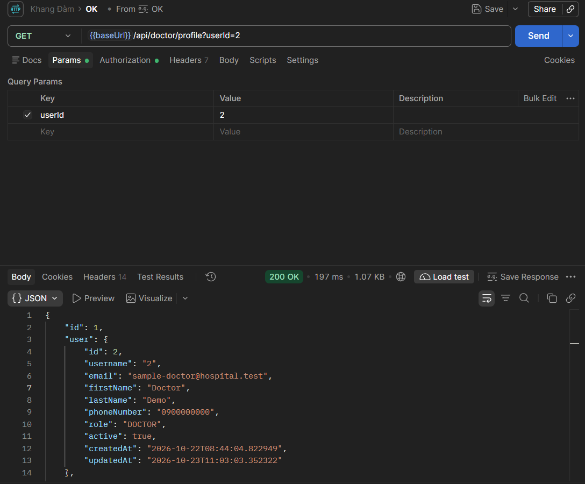
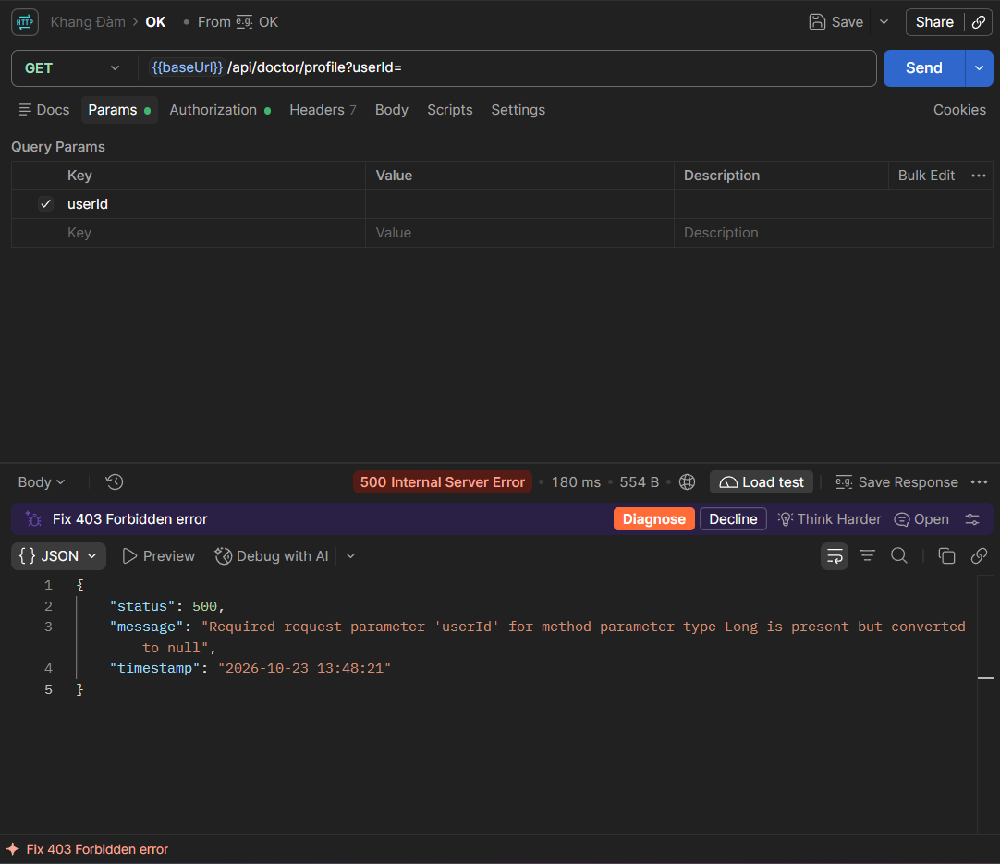
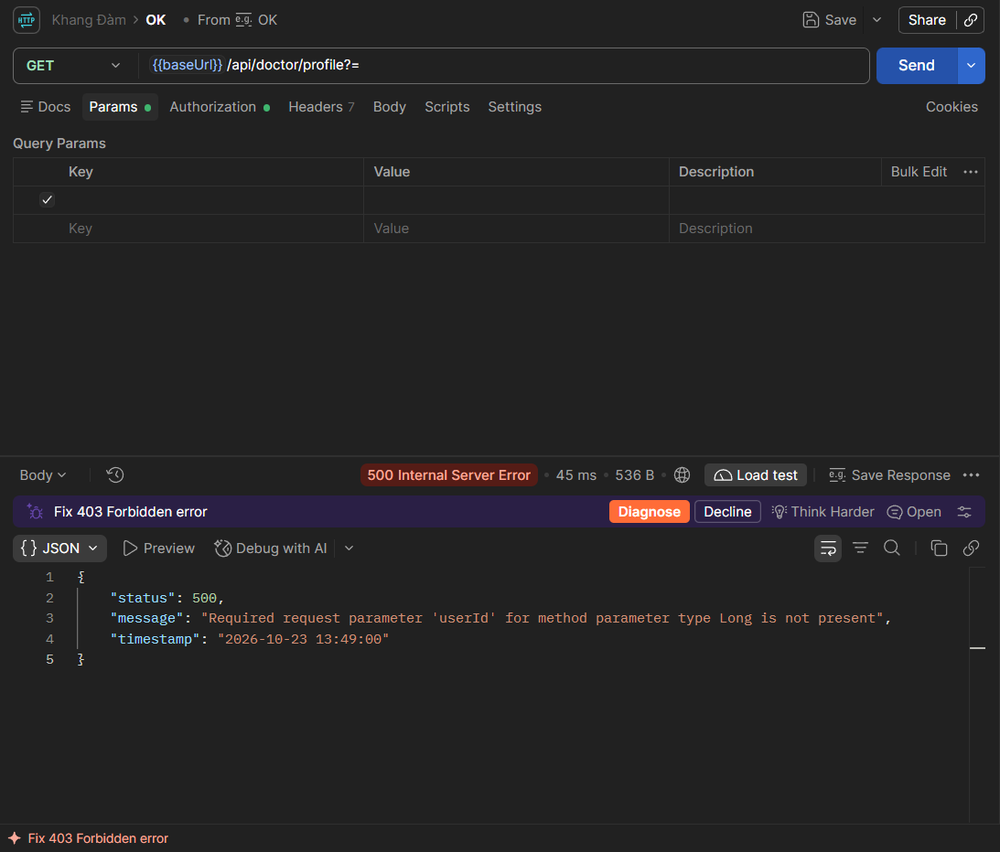
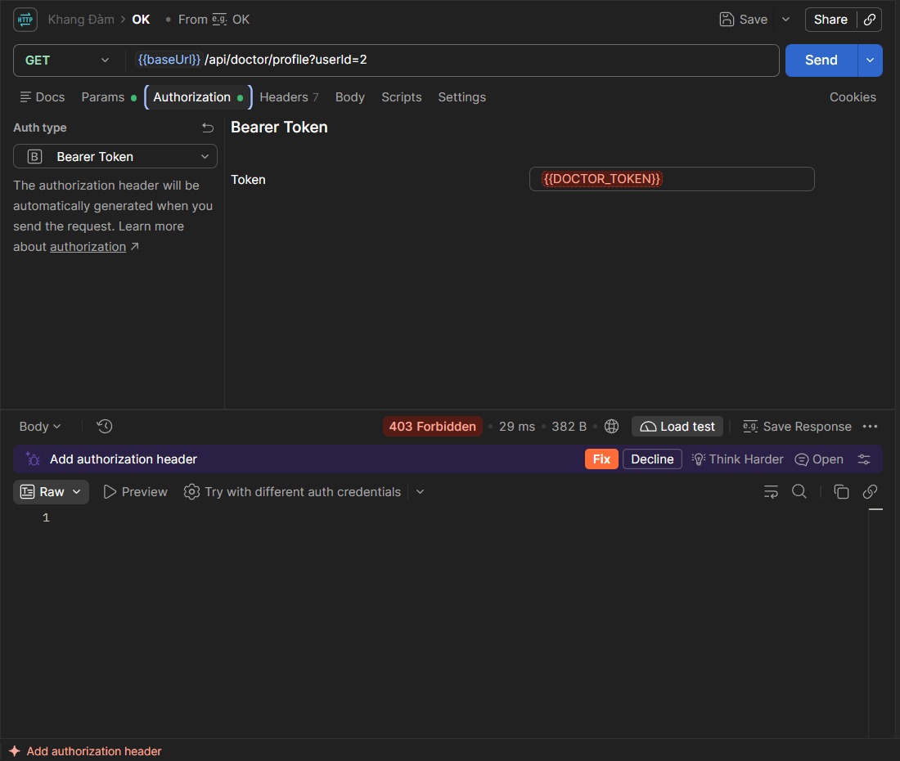
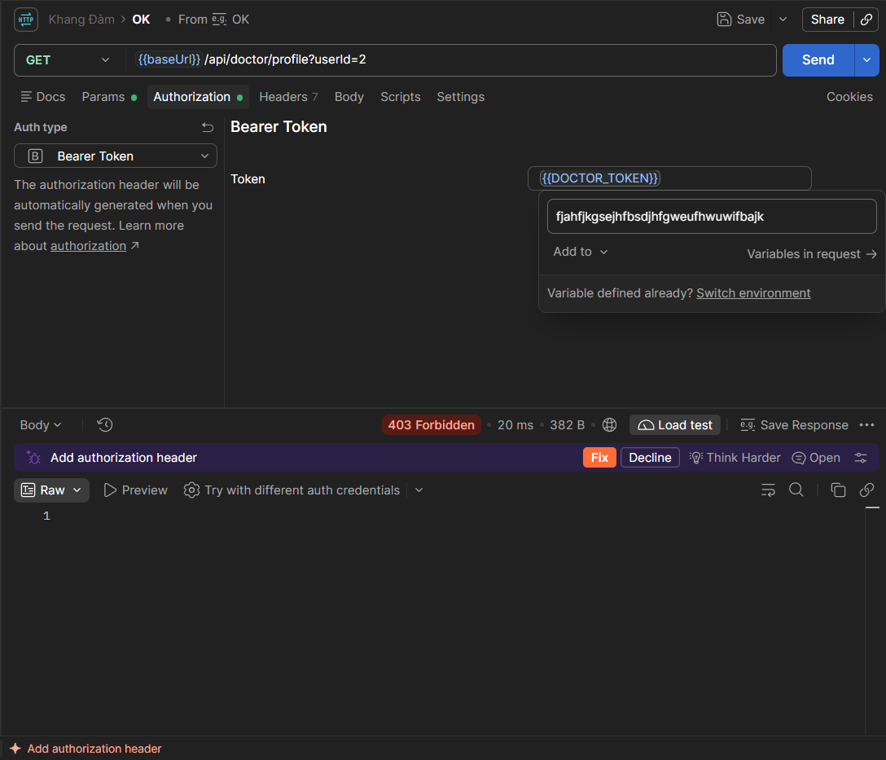
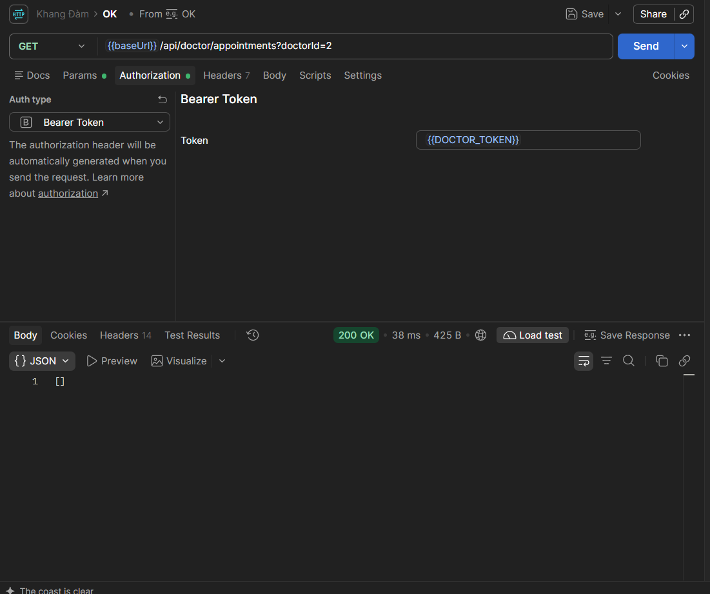
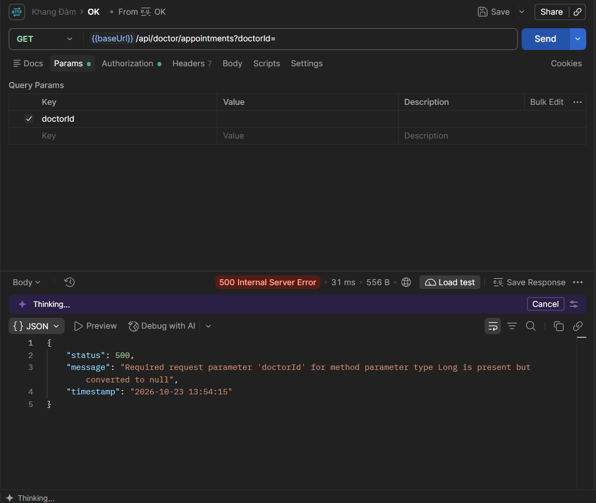
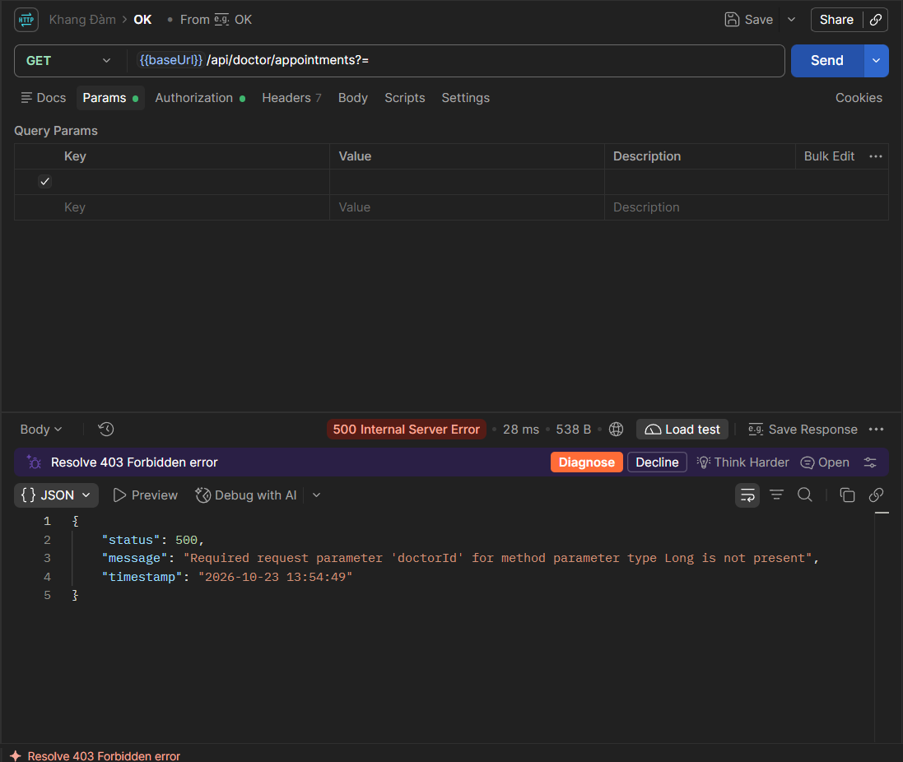
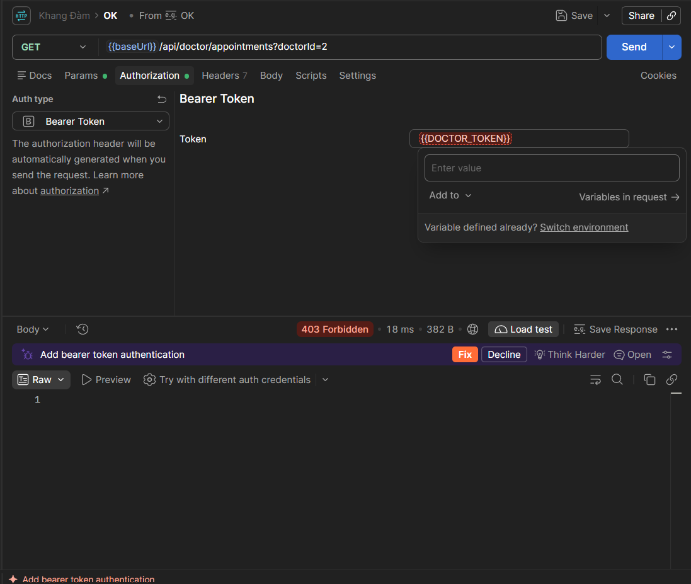
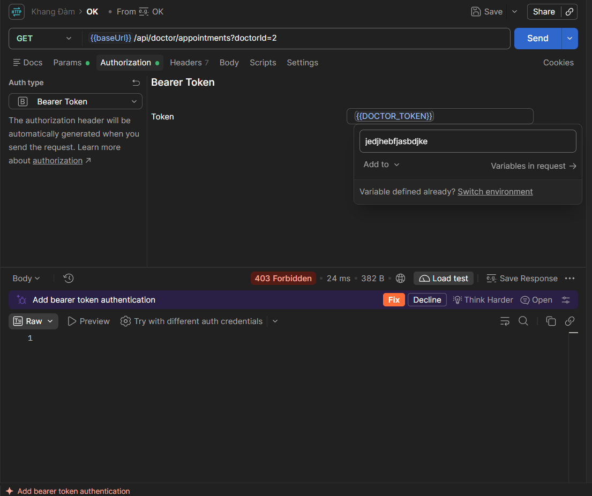

# Báo cáo rà soát API — Khang Đàm — Tuần 03

## 1. Thông tin chung

| Hạng mục | Nội dung |
|---|---|
| Người thực hiện | Khang Đàm |
| Phạm vi | API hồ sơ bác sĩ và danh sách lịch hẹn |
| Base URL dự kiến | `http://localhost:8080` |
| Environment variable | `{{baseUrl}}`, `{{DOCTOR_TOKEN}}` |
| API 1 | `GET /api/doctor/profile` |
| API 2 | `GET /api/doctor/appointments` |

Mục tiêu là rà soát phản hồi HTTP, cách xử lý tham số đầu vào và cơ chế xác thực/phân quyền. Báo cáo chỉ xác nhận kết quả có căn cứ trong tài liệu hiện có; các kết quả chưa có bằng chứng cần được chạy lại trên Postman trước khi kết luận.

**Lưu ý về tính nhất quán:** Bản nháp ban đầu ghi `PROFILE-01` trả `200 OK` trong bảng kiểm thử, nhưng phần mô tả sự cố lại ghi cùng request trả `403 Forbidden`. Vì chưa có ảnh response đính kèm để phân xử, kết quả của trường hợp này được đánh dấu **cần xác minh**, không khẳng định một trong hai trạng thái là kết quả cuối cùng.

## 2. Cấu hình request

### 2.1. `GET /api/doctor/profile`

- **Method:** `GET`
- **URL:** `{{baseUrl}}/api/doctor/profile`
- **Query parameter:** `userId=2`
- **Request mẫu:** `{{baseUrl}}/api/doctor/profile?userId=2`
- **Authorization:** Tab Authorization được cấu hình trong Postman; ảnh hiện tại không hiển thị giá trị token nên không ghi lại token trong báo cáo.
- **Body:** Không cần body cho request GET.
- **Kết quả theo ảnh Postman:** `200 OK`, thời gian phản hồi `197 ms`, kích thước response `1.07 KB`.

Response JSON hiển thị object hồ sơ với `id: 1`; object `user` bên trong có `id: 2`, `username: "2"`, `email: "sample-doctor@hospital.test"`, `firstName: "Doctor"`, `lastName: "Demo"`, `role: "DOCTOR"` và `active: true`. Đây là kết quả thành công được xác nhận bởi ảnh Postman mới cung cấp.

### 2.2. `GET /api/doctor/appointments`

- **Method:** `GET`
- **URL:** `{{baseUrl}}/api/doctor/appointments`
- **Query parameter:** `doctorId`
- **Authorization:** `Bearer Token` nếu endpoint yêu cầu xác thực.
- **Body:** Không cần body cho request GET.

Bản nháp có ghi `doctorId=2` trả `200 OK` với mảng rỗng `[]`, nhưng chưa có ảnh response trong tệp được cung cấp. Cần kiểm tra lại trên môi trường thực tế trước khi dùng làm bằng chứng nghiệm thu.

## 3. Bảng kiểm thử

**Quy ước trạng thái**
- **Cần xác minh:** Bản nháp có ghi kết quả nhưng thiếu bằng chứng hoặc có thông tin mâu thuẫn.
- **Chưa xác nhận:** Chưa có response/bằng chứng đủ để kết luận.
- Mã HTTP trong cột kết quả là thông tin được ghi trong bản nháp, không thay thế cho bằng chứng Postman.

| Test ID | Trường hợp | Kết quả được ghi trong bản nháp | Trạng thái hiện tại | Hướng xử lý |
|---|---|---|---|---|
| `PROFILE-01` | `userId=2`, token Doctor | `200 OK`; response trả về object hồ sơ, `id=1`, thông tin `user` có `id=2`, `role=DOCTOR`, `active=true` | **Đã xác nhận theo ảnh Postman** | Request thành công. Lưu ý `id` ngoài cùng là `1`, còn `user.id` là `2`; cần giữ đúng phân biệt này khi đối chiếu dữ liệu |
| `PROFILE-02` | `userId=` (tham số có nhưng rỗng) | `500 Internal Server Error`; thông báo tham số `userId` được chuyển thành `null` | Cần xác minh bằng ảnh/log | Kiểm tra validation và xử lý lỗi đầu vào |
| `PROFILE-03` | Không truyền `userId` | `500 Internal Server Error`; thông báo thiếu required request parameter `userId` | Cần xác minh bằng ảnh/log | Kiểm tra exception handler; tham số bắt buộc thường nên trả `400 Bad Request` |
| `PROFILE-04` | Không gửi token | `403 Forbidden` | Cần xác minh bằng ảnh response | Chạy lại request không có Authorization |
| `PROFILE-05` | Token giả/không hợp lệ | `403 Forbidden` | Cần xác minh bằng ảnh response | Chạy lại với token thử nghiệm không hợp lệ |
| `APPT-01` | `doctorId=2`, token được cấp quyền | `200 OK`; response `[]` | Cần xác minh bằng ảnh response | Kiểm tra dữ liệu lịch hẹn và quyền truy cập |
| `APPT-02` | `doctorId=` (tham số có nhưng rỗng) | `500 Internal Server Error`; thông báo tham số `doctorId` được chuyển thành `null` | Cần xác minh bằng ảnh/log | Kiểm tra validation và xử lý lỗi đầu vào |
| `APPT-03` | Không truyền `doctorId` | `500 Internal Server Error`; thông báo thiếu required request parameter `doctorId` | Cần xác minh bằng ảnh/log | Kiểm tra exception handler; tham số bắt buộc thường nên trả `400 Bad Request` |
| `APPT-04` | Không gửi token | `403 Forbidden` | Cần xác minh bằng ảnh response | Chạy lại request không có Authorization |
| `APPT-05` | Token giả/không hợp lệ | `403 Forbidden` | Cần xác minh bằng ảnh response | Chạy lại với token thử nghiệm không hợp lệ |

> Không dùng `PROFILE-02`/`PROFILE-03` hoặc `APPT-02`/`APPT-03` làm bằng chứng lỗi đã xác nhận nếu chưa lưu được response thực tế. Các mã trạng thái ở trên là kết quả được ghi trong bản nháp.

## 4. Phân tích và hướng xử lý

### 4.1. Sự cố `403 Forbidden` ở Doctor Profile

Thông báo `Access to the resource is prohibited.` cho thấy request bị từ chối, nhưng riêng thông báo này chưa đủ để kết luận nguyên nhân là token sai. Các khả năng cần kiểm tra:

1. **Environment:** Đã chọn đúng Environment chưa? Xác nhận `{{baseUrl}}` có giá trị `http://localhost:8080` khi backend chạy tại cổng đó.
2. **Token:** Kiểm tra `{{DOCTOR_TOKEN}}` đã được đặt giá trị, chưa hết hạn và được cấp cho tài khoản có quyền phù hợp. Không đưa token thật vào báo cáo hoặc commit.
3. **Role và quyền truy cập:** Kiểm tra role trong token và quy tắc phân quyền của endpoint.
4. **ID đầu vào:** Xác nhận `userId=2` tồn tại và người gọi được phép xem hồ sơ tương ứng.
5. **Backend:** Đối chiếu log server, cấu hình Spring Security (nếu dùng) và code controller/service.

Sau khi kiểm tra, cập nhật kết quả bằng chứng và ghi rõ nguyên nhân đã xác nhận hoặc vẫn chưa xác định.

### 4.2. Xử lý tham số thiếu hoặc rỗng

Theo bản nháp, các trường hợp thiếu/rỗng `userId` và `doctorId` từng được ghi nhận là `500 Internal Server Error`. Nếu chạy lại và tái hiện được, đây là vấn đề cần xem xét: dữ liệu đầu vào không hợp lệ thường nên được trả về `400 Bad Request`, thay vì lỗi 500.

Hướng xử lý phía backend:
- Kiểm tra khai báo tham số bắt buộc và kiểu dữ liệu trong controller.
- Chuẩn hóa xử lý ngoại lệ để lỗi đầu vào có phản hồi rõ ràng, không làm lộ stack trace.
- Bổ sung kiểm thử cho tham số bị thiếu, rỗng, không phải số và ID không tồn tại.
- Xác nhận quy tắc trả lỗi theo hợp đồng API trước khi thay đổi code.

### 4.3. Response rỗng ở danh sách lịch hẹn

Nếu `GET /api/doctor/appointments?doctorId=2` trả `200 OK` và `[]`, điều đó có thể biểu thị không có lịch hẹn phù hợp; không tự động có nghĩa API bị lỗi. Cần xác nhận ID bác sĩ tồn tại, dữ liệu thử nghiệm có lịch hẹn hay không và endpoint có lọc đúng theo quyền truy cập.

## 5. Checklist chạy lại trên Postman

- [ ] Chọn đúng Environment.
- [ ] Xác nhận `{{baseUrl}}` là `http://localhost:8080`.
- [ ] Xác nhận `{{DOCTOR_TOKEN}}` có giá trị hợp lệ; không chụp/lưu token thật trong bằng chứng.
- [ ] Chạy `PROFILE-01` với `userId=2` và lưu status/body.
- [ ] Chạy các trường hợp thiếu/rỗng/sai `userId`.
- [ ] Chạy các trường hợp không token/token không hợp lệ.
- [ ] Chạy `APPT-01` với `doctorId` hợp lệ và lưu status/body.
- [ ] Chạy các trường hợp thiếu/rỗng/sai `doctorId`.
- [ ] Chạy các trường hợp không token/token không hợp lệ.
- [ ] Ghi thời gian phản hồi nếu cần theo tiêu chí của nhóm.
- [ ] Cập nhật bảng kiểm thử theo kết quả thực tế và đính kèm ảnh đã che dữ liệu nhạy cảm.

## 6. Bằng chứng kiểm thử

6.1. Ảnh bằng chứng API GET Doctor Profile

PROFILE-01 — `userId=2`, `200 OK`

PROFILE-02 — `userId=`, `500 Internal Server Error`

PROFILE-03 — `Thiếu userId`, `500 Internal Server Error`

PROFILE-04 — `Không có token`, `403 Forbidden`

PROFILE-05 — `Token giả/không hợp lệ`, `403 Forbidden`

6.2. Ảnh bằng chứng API GET Doctor Appointments

APPT-01 — `doctorId=2`, `200 OK`, `response []`

APPT-02 — `doctorId=`, `500 Internal Server Error`	

APPT-03 — `Thiếu doctorId`, `500 Internal Server Error`

APPT-04 — `Không có token`, `403 Forbidden`

APPT-05 — `Token giả/không hợp lệ`, `403 Forbidden`

## 7. Kết luận

- Phạm vi rà soát gồm 2 endpoint GET: hồ sơ bác sĩ và danh sách lịch hẹn.
- `PROFILE-01` đã được xác nhận theo ảnh Postman: `200 OK` cho request `userId=2`; response có `user.id=2` và `role=DOCTOR`.
- Các kết quả khác trong bảng vẫn cần được đối chiếu với ảnh response/log trước khi xem là đã xác nhận.
- Nếu lỗi thiếu/rỗng tham số trả `500`, nên xem xét chuẩn hóa thành `400 Bad Request` theo hợp đồng API.
- Chưa đủ bằng chứng để kết luận toàn bộ hai API đạt yêu cầu hoặc xác nhận nguyên nhân lỗi phân quyền.

## 8. Liên kết công việc

- Jira task: Chưa cập nhật.
- GitHub commit: Cập nhật sau khi commit và push.
- Pull Request: Cập nhật nếu quy trình của nhóm sử dụng Pull Request.

---

