# Báo cáo rà soát API — Phúc Cường — Tuần 03

## 1. Thông tin chung

- Người thực hiện: Phúc Cường
- Công cụ: Postman
- API đang rà soát: `GET /api/patient/appointments`
- Mục tiêu: Kiểm tra phản hồi API, cách xử lý tham số đầu vào, xác thực và phạm vi dữ liệu lịch hẹn trả về.
- Môi trường: Postman environment `HMS Local`
- Thời điểm thực hiện: 22/10/2026 (theo thời gian hiển thị trên ảnh Postman)

> Báo cáo này ghi nhận kết quả nhìn thấy trong ảnh Postman. Các nhận định về lỗi cần được đối chiếu với yêu cầu nghiệp vụ và code trước khi xác nhận chính thức.

## 2. Cấu hình request quan sát được

- Method: `GET`
- URL cơ sở: `{{baseUrl}}/api/patient/appointments`
- Query parameter: `patientId`
- Authorization: Bearer Token với biến `{{PATIENT_TOKEN}}` trong request đã cấu hình xác thực.
- Response thành công trong các ảnh có dạng JSON array.

## 3. Kết quả kiểm thử

| Test ID | Trường hợp | Kết quả thực tế trên Postman | Nhận xét ban đầu |
|---|---|---|---|
| GET-01 | `patientId=1` | `200 OK`; response là danh sách lịch hẹn, ảnh cho thấy `patient.id=1`, lịch hẹn có `id=1`, trạng thái `CONFIRMED` | API trả dữ liệu. Cần đối chiếu toàn bộ dữ liệu với dữ liệu thử nghiệm mong đợi. |
| GET-02 | `patientId=999999` | `200 OK`; response body `[]` | API trả danh sách rỗng cho ID này. Chưa xác minh riêng ID bệnh nhân có tồn tại hay không. |
| GET-03 | Bỏ `patientId` | `500 Internal Server Error`; message: `Required request parameter 'patientId' for method parameter type Long is not present` | Có dấu hiệu API trả 500 khi thiếu tham số bắt buộc. Cần đối chiếu yêu cầu xử lý lỗi. |
| GET-04 | `patientId=abc` | `500 Internal Server Error`; message cho biết không chuyển được `java.lang.String` sang `java.lang.Long` với giá trị `abc` | Có dấu hiệu API trả 500 với tham số sai định dạng. Cần kiểm tra xử lý lỗi đầu vào. |
| GET-05 | `patientId=0` | `200 OK`; response body `[]` | API trả danh sách rỗng. Cần đối chiếu yêu cầu đối với ID bằng 0. |
| GET-06 | `patientId=-1` | `200 OK`; response body `[]` | API trả danh sách rỗng. Cần đối chiếu yêu cầu đối với ID âm. |
| GET-07 | Không có token | `403 Forbidden` | Request bị từ chối trong lần thử này. Cần xác minh theo cấu hình bảo mật. |
| GET-08 | Token giả/không hợp lệ | `403 Forbidden` | Request bị từ chối trong lần thử này. Cần xác minh theo yêu cầu xác thực. |
| GET-09 | `patientId=2` với token bệnh nhân đang dùng | `200 OK`; response có `patient.id=2` | Người kiểm thử cho biết token thuộc bệnh nhân 1 nhưng truy vấn được dữ liệu lịch hẹn bệnh nhân 2. Đây là dấu hiệu cần xác minh về kiểm soát truy cập cấp đối tượng (IDOR/BOLA). |

## 4. Vấn đề cần xác minh

### Issue 1 — HTTP 500 khi thiếu hoặc sai định dạng `patientId`

- Tái hiện:
  1. Gửi `GET /api/patient/appointments` không có `patientId`.
  2. Gửi `GET /api/patient/appointments?patientId=abc`.
- Kết quả quan sát:
  - Thiếu tham số: `500 Internal Server Error`.
  - Sai định dạng: `500 Internal Server Error`.
- Nhận định: Có thể cần xử lý lỗi đầu vào rõ ràng hơn thay vì trả lỗi máy chủ. Cần kiểm tra hợp đồng API và quy ước lỗi của dự án trước khi xác nhận bug.

### Issue 2 — Có khả năng truy cập lịch hẹn của bệnh nhân khác

- Tái hiện theo thông tin người kiểm thử:
  1. Dùng token của bệnh nhân 1.
  2. Gửi `GET /api/patient/appointments?patientId=2`.
  3. API trả `200 OK` và response hiển thị `patient.id=2`.
- Mức độ cần chú ý: Cao — liên quan đến dữ liệu bệnh nhân.
- Nhận định: Nếu bệnh nhân chỉ được phép xem lịch hẹn của chính mình, đây có thể là lỗi phân quyền cấp đối tượng (IDOR/BOLA). Cần xác nhận role/danh tính của token, yêu cầu API và quyền truy cập dự kiến.
- Khuyến nghị: Nhóm phát triển kiểm tra backend có ràng buộc dữ liệu theo người dùng đã xác thực hay chỉ dựa vào `patientId` do client truyền lên. Chỉ sử dụng dữ liệu thử nghiệm được cho phép.

## 5. Tổng kết API GET

- Số trường hợp được ghi nhận: 9.
- Các request có `patientId` trả `200 OK` trong các ảnh được cung cấp.
- Hai trường hợp đầu vào thiếu/sai định dạng trả `500 Internal Server Error`, cần xác minh xử lý lỗi.
- Trường hợp truy vấn `patientId=2` bằng token được người kiểm thử xác định là của bệnh nhân 1 trả dữ liệu có `patient.id=2`; cần ưu tiên xác minh phân quyền.
- Các trường hợp không có token và token giả trả `403 Forbidden` trong ảnh.
- Đây là rà soát ban đầu, không thay thế việc xác nhận bug bằng yêu cầu nghiệp vụ và kiểm tra code.

## 6. Bằng chứng Postman

Đính kèm ảnh tương ứng cho từng trường hợp:
- `GET-01` — patientId hợp lệ có dữ liệu.
- `GET-02` — patientId=999999.
- `GET-03` — thiếu patientId.
- `GET-04` — patientId=abc.
- `GET-05` — patientId=0.
- `GET-06` — patientId=-1.
- `GET-07` — không có token.
- `GET-08` — token không hợp lệ.
- `GET-09` — truy vấn patientId=2 với token bệnh nhân 1.


### 6.1. Ảnh bằng chứng API GET

Các ảnh dưới đây được nhúng trực tiếp từ thư mục `evidence/`. Bấm ảnh để xem rõ hơn.

**GET-01 — `patientId=1`, `200 OK`**
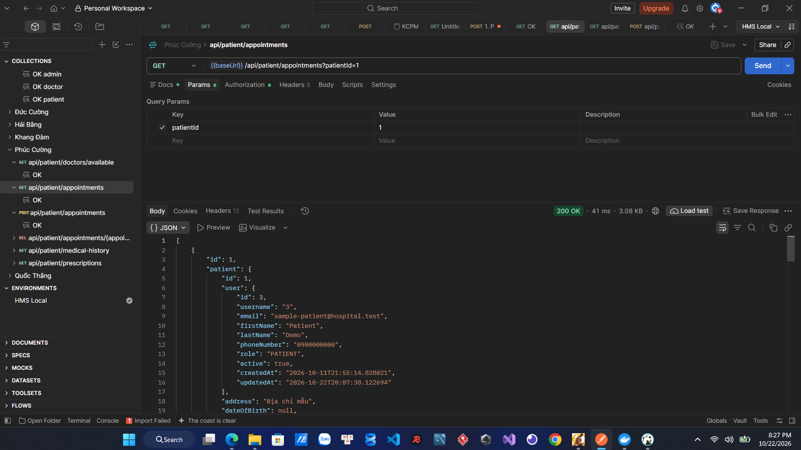

**GET-02 — `patientId=999999`, `200 OK`, body `[]`**
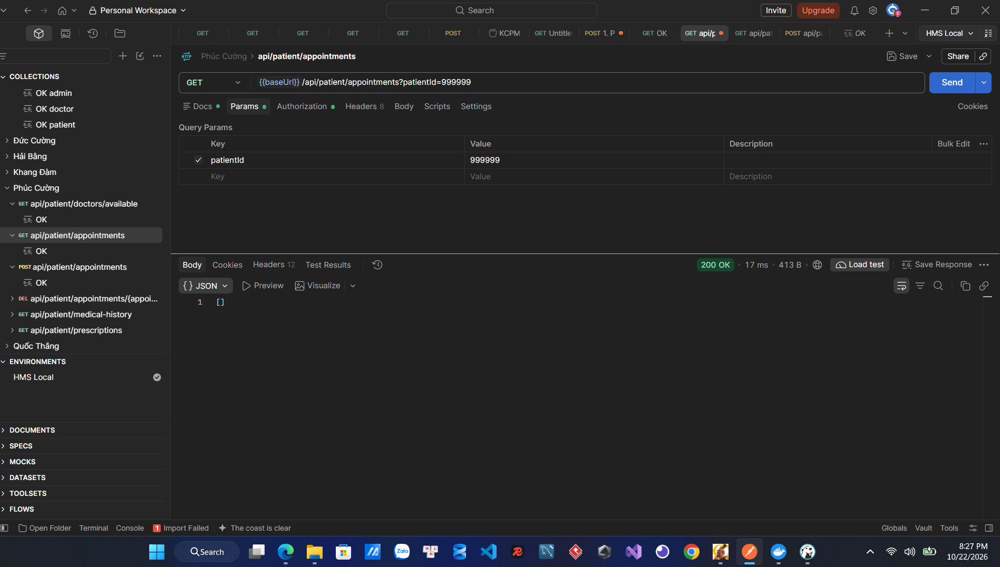

**GET-03 — Thiếu `patientId`, `500 Internal Server Error`**


**GET-04 — `patientId=abc`, `500 Internal Server Error`**
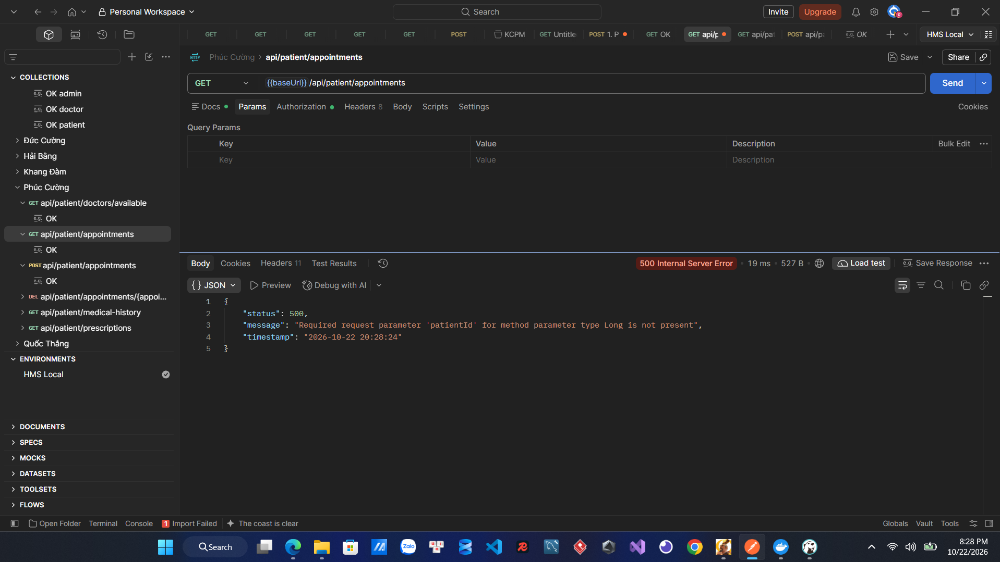

**GET-05 — `patientId=0`, `200 OK`, body `[]`**
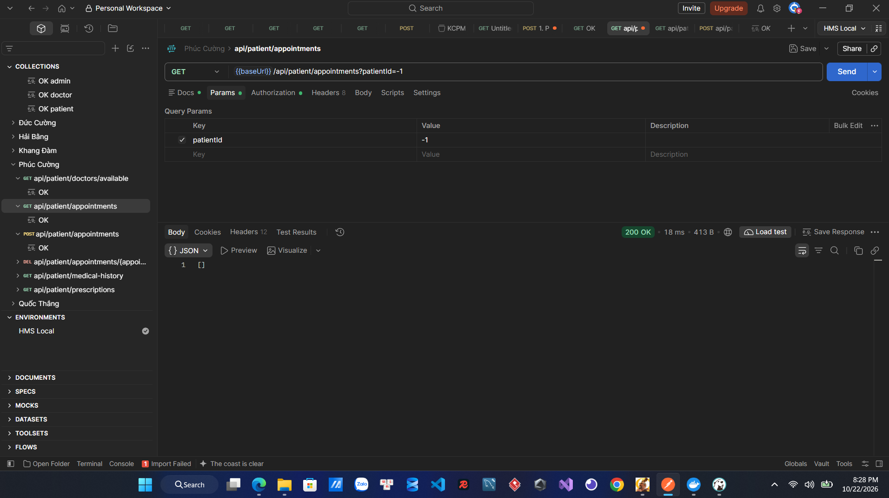

**GET-06 — `patientId=-1`, `200 OK`, body `[]`**
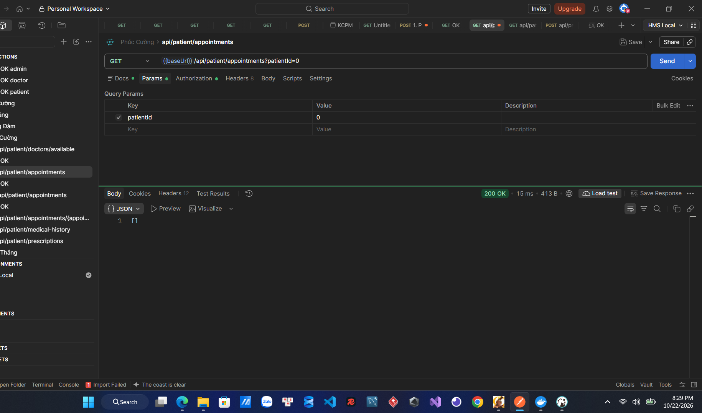

**GET-07 — Không có token, `403 Forbidden`**
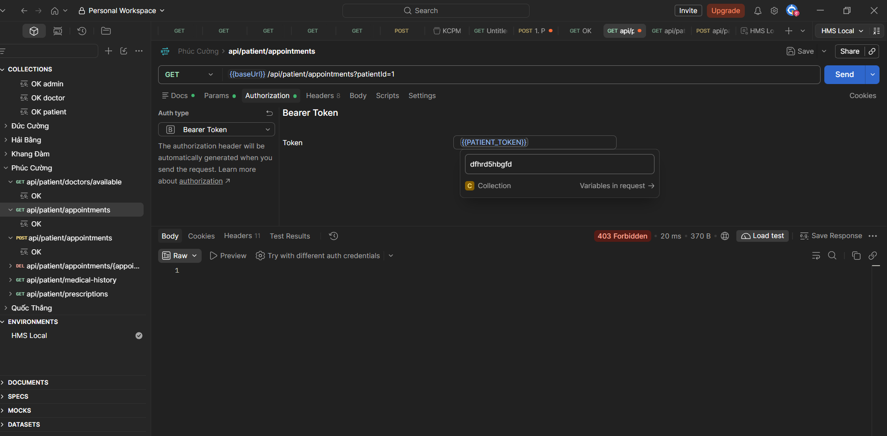

**GET-08 — Token không hợp lệ/không được chấp nhận, `403 Forbidden`**
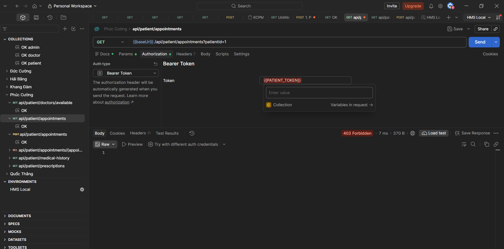

**GET-09 — Truy vấn `patientId=2`, response có `patient.id=2`, `200 OK`**
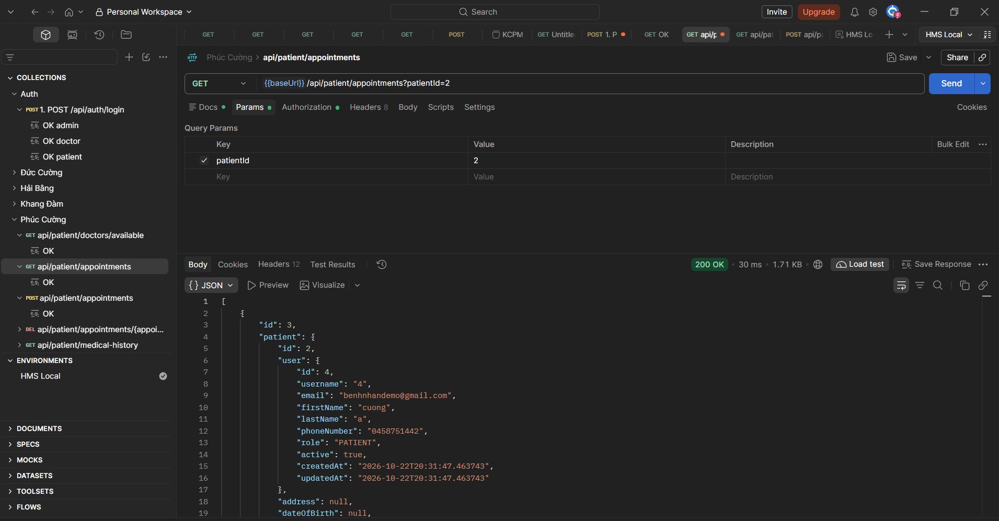

## 7. Liên kết công việc

- Jira task: [Bổ sung link task Jira]
- GitHub commit: [Bổ sung sau khi commit và push]
- Pull Request: [Bổ sung nếu nhóm sử dụng PR]

## 8. Phạm vi còn lại

API thứ hai `POST /api/patient/appointments` chưa được rà soát trong báo cáo này. Sẽ bổ sung kết quả sau khi hoàn thành kiểm thử API POST.


---

## 9. Rà soát API POST — Tạo lịch hẹn bệnh nhân

### 9.1. Thông tin request

- Method: `POST`
- URL quan sát được trên Postman: `{{baseUrl}}/api/patient/appointments?patientId=1`
- Environment: `HMS Local`
- Authorization: Bearer Token; request đã thử với biến `{{PATIENT_TOKEN}}` và cả trường hợp không có token.
- Body: `raw` / `JSON`

Body dùng trong lần tạo lịch hẹn thành công:

```json
{
  "departmentId": 1,
  "doctorId": 1,
  "appointmentDateTime": "2026-11-10T09:00:00",
  "reason": "Khám sức khỏe định kỳ",
  "notes": "Ghi chú mẫu"
}
```

**Lưu ý về `patientId`:** Trong request quan sát được, `patientId=1` nằm ở query string trên URL, không nằm trong Body. Chưa có tài liệu hoặc mã Controller trong bằng chứng hiện tại để xác nhận API bắt buộc lấy `patientId` từ query parameter hay từ danh tính trong token.

### 9.2. Kết quả kiểm thử

| Test ID | Trường hợp | Kết quả thực tế trên Postman | Nhận xét ban đầu |
|---|---|---|---|
| POST-01 | Tạo lịch hẹn với `departmentId=1`, `doctorId=1` và dữ liệu lịch hẹn đã gửi | `200 OK`; response có `id=4` và `patient.id=1` | API đã tạo/trả về một lịch hẹn trong môi trường test. Không gửi lại nhiều lần để tránh tạo dữ liệu trùng. |
| POST-02 | Thiếu trường `departmentId` trong Body | `400 Bad Request`; message `Validation failed`; lỗi `Department ID is required` | API trả lỗi validation cho trường bị thiếu. |
| POST-03 | Nhập `doctorId` là `as` không có dấu ngoặc kép, khiến JSON không hợp lệ | `500 Internal Server Error`; message `JSON parse error: Invalid UTF-8 start byte 0xa2` | Lần thử này kiểm tra JSON không hợp lệ, chưa phải trường hợp JSON hợp lệ nhưng sai kiểu dữ liệu. |
| POST-04 | Dùng `doctorId=9999999` | `404 Not Found`; message `Doctor not found with id: 9999999` | API phát hiện không có bác sĩ tương ứng với ID đã gửi. |
| POST-05 | Gửi request không có token | `403 Forbidden` | Request bị từ chối trong lần thử này. |
| POST-06 | Gửi request với `{{PATIENT_TOKEN}}` nhưng kết quả vẫn là `403 Forbidden` | `403 Forbidden` | Chưa xác nhận được biến token có giá trị hợp lệ, còn hạn và đúng quyền hay không. Cần kiểm tra cấu hình environment/login trước khi kết luận API từ chối token hợp lệ. |

### 9.3. Nhận xét và điểm cần xác minh

1. **Validation đầu vào:** Khi thiếu `departmentId`, API trả `400 Bad Request` với thông báo cụ thể. Cần kiểm tra thêm các trường bắt buộc khác theo request DTO hoặc tài liệu API.
2. **ID bác sĩ không tồn tại:** `doctorId=9999999` trả `404 Not Found`, kèm thông báo `Doctor not found with id: 9999999`.
3. **JSON không hợp lệ:** Body có `doctorId: as` không phải JSON hợp lệ và trả `500 Internal Server Error`. Cần thử lại bằng JSON hợp lệ nhưng sai kiểu, ví dụ `"doctorId": "abc"`, để xác định cách API xử lý lỗi chuyển đổi dữ liệu.
4. **Xác thực:** Cả request không có token và request dùng `{{PATIENT_TOKEN}}` đều cho `403 Forbidden` trong các ảnh đã cung cấp. Cần kiểm tra giá trị token và quyền của tài khoản trước khi xác nhận đây là lỗi phân quyền.
5. **Nguồn của `patientId`:** URL có `?patientId=1`, trong khi Body không có trường `patientId`. Cần kiểm tra Controller/DTO hoặc tài liệu API để xác nhận hợp đồng API; không tự kết luận rằng `patientId` bắt buộc nằm trong Body.

### 9.4. Tổng kết API POST

- Số trường hợp đã ghi nhận từ ảnh: **6**.
- Một request tạo lịch hẹn trả `200 OK` và response có `id=4`.
- Thiếu `departmentId` trả `400 Bad Request`.
- `doctorId=9999999` trả `404 Not Found`.
- Body JSON không hợp lệ trả `500 Internal Server Error`.
- Hai lần thử liên quan đến Authorization trả `403 Forbidden`; cần xác minh token trước khi kết luận.
- Đây là kết quả thực tế quan sát được, chưa thay thế việc đối chiếu với yêu cầu nghiệp vụ và mã nguồn.

### 9.5. Bằng chứng Postman cho API POST

**POST-01 — Tạo lịch hẹn thành công (`200 OK`, response có `id=4`)**
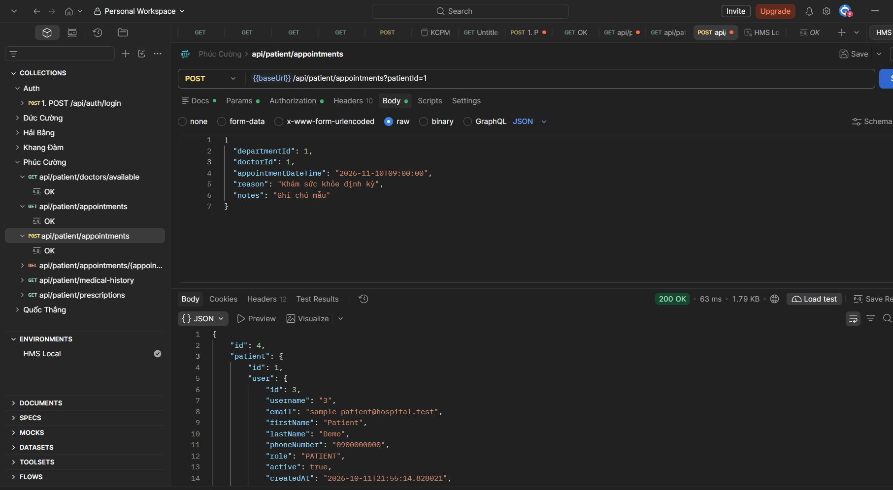

**POST-02 — Thiếu `departmentId` (`400 Bad Request`)**
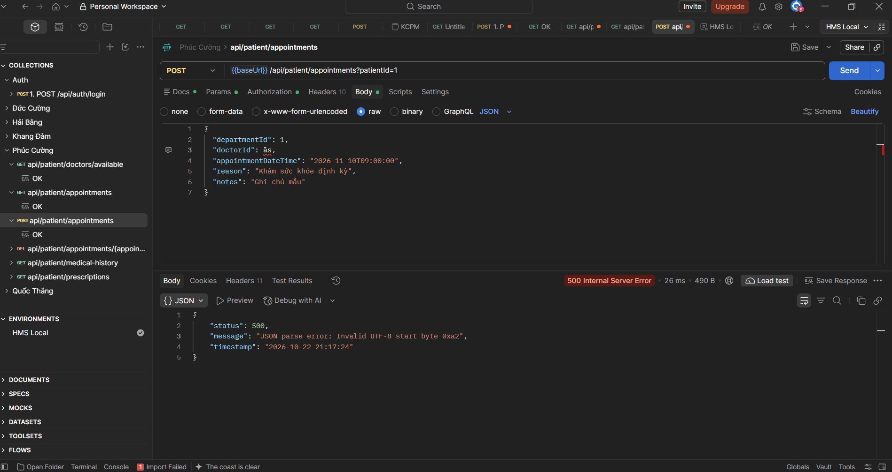

**POST-03 — JSON không hợp lệ (`500 Internal Server Error`)**
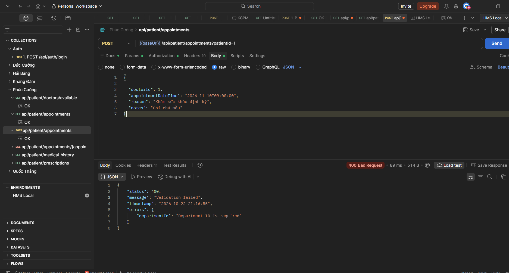

**POST-04 — `doctorId=9999999`, bác sĩ không tồn tại (`404 Not Found`)**
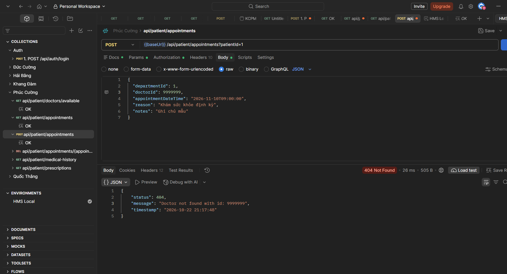

**POST-05 — Không có token (`403 Forbidden`)**
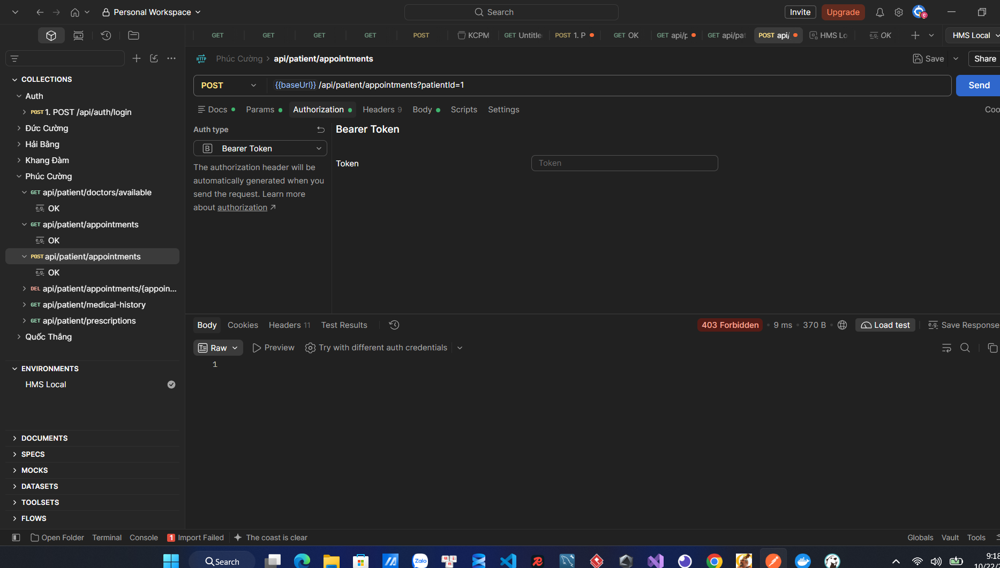

**POST-06 — Có cấu hình `{{PATIENT_TOKEN}}` nhưng trả `403 Forbidden`**
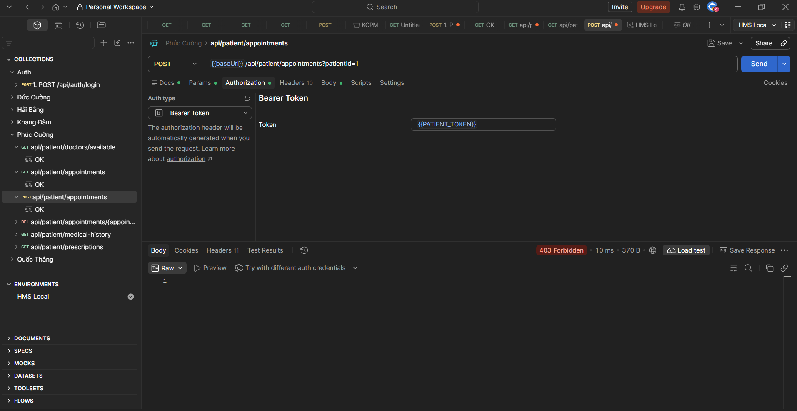
